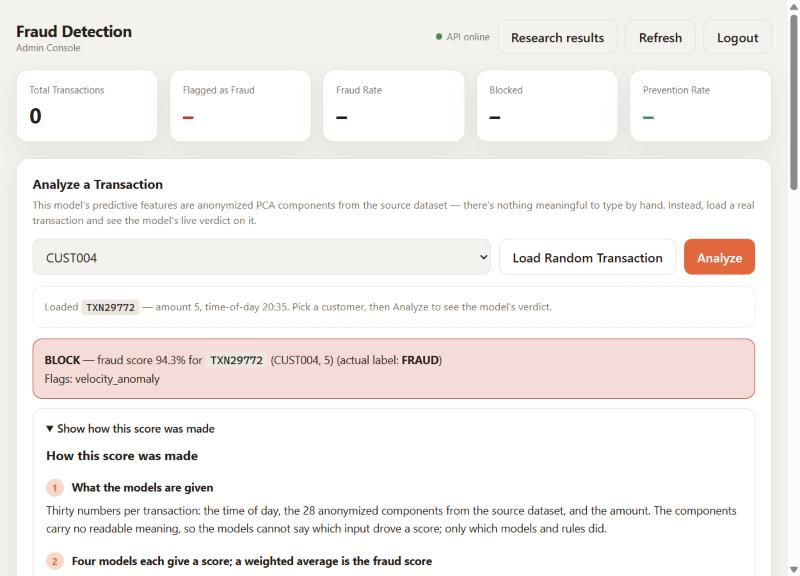
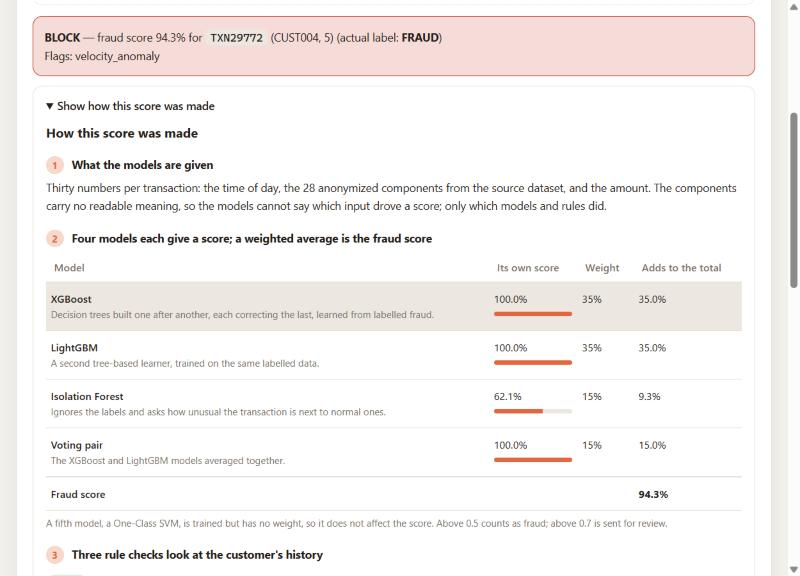
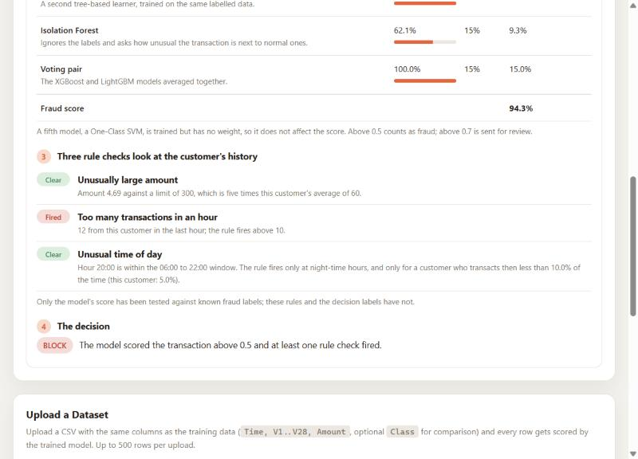
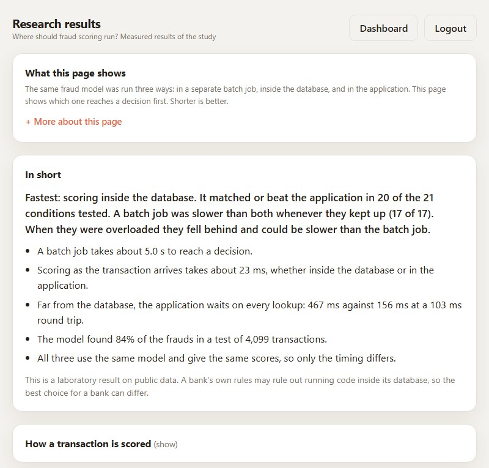
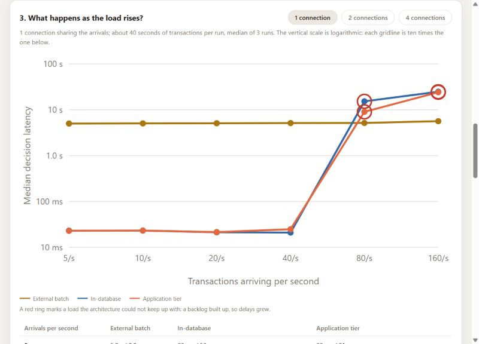
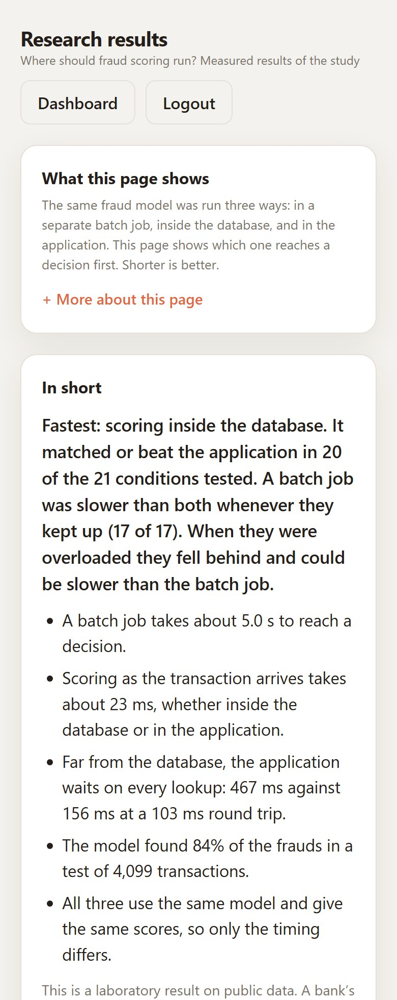
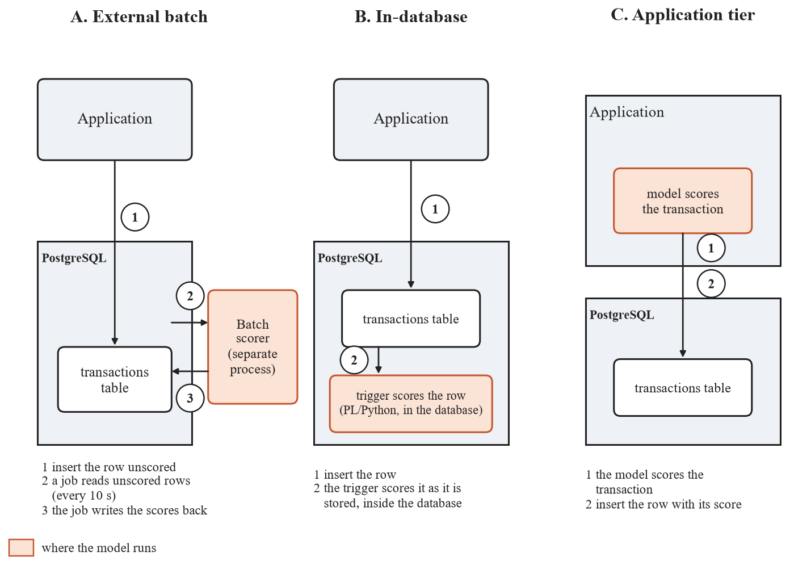
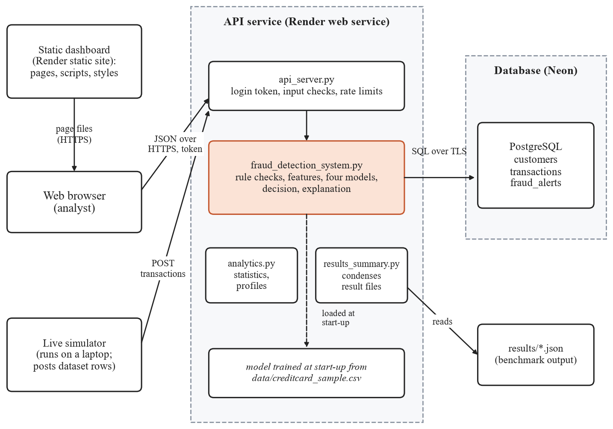

# Near-Data Fraud Scoring for Ugandan Banking

A research prototype and benchmark for one question:

> How can machine-learning fraud scoring be integrated close to transaction data to provide timely fraud detection under the technical constraints relevant to the Ugandan banking environment?

It is a project for ISBAT University (course BIT3239). The code builds one fraud model, runs it in three places (an external batch job, inside the database, and in the application tier), and measures how detection quality, decision latency and system cost change with load and with the distance between application and database.

**What this is not.** It is not a production system. It uses a public European card dataset as a proxy, because no bank data was requested or used, so it says nothing about fraud rates or patterns in Uganda. Its login password is set by whoever runs it (see Security settings). The numbers below come from one laptop.

---

## What was measured

All figures are in `results/` and are described, with their limits, in `SYSTEM_SUMMARY.md`. Latency is the time from a transaction's scheduled arrival to its committed fraud score, so queueing is included.

**Detection quality** (time-ordered split, 75 frauds in the test set, real fraud prevalence restored, 95% bootstrap intervals): precision 0.39 (0.25 to 0.68), recall 0.84 (0.75 to 0.92), F1 score 0.53 (0.38 to 0.76), PR-AUC 0.75 (0.62 to 0.90), false-positive rate 0.0017. With so few frauds these intervals are wide.

**Three architectures at 10 transactions per second, one connection** (median of 3 runs):

| | External batch | In-database | Application tier |
|---|---|---|---|
| Decision latency, median | 5,045 ms | 23.2 ms | 23.1 ms |
| Decision latency, 99th percentile | 9,944 ms | 77.7 ms | 79.0 ms |
| Processor seconds per 1,000 transactions | 1.47 | 23.7 | 23.6 |

Scores were identical in all three architectures in every run.

**Rate sweep** (5 to 160 transactions per second, 1 to 4 connections, `results/rate_sweep.json`):
- Batch latency stays set by its 10-second polling interval at every load, and the batch job kept up with 160 transactions per second.
- Scoring on arrival decides in about 20 ms until one connection's capacity of about 55 transactions per second is exceeded, then a backlog builds and delays grow to seconds. Two connections held about 100 per second and four about 110 to 132 on this four-core laptop.
- Memory grows with the number of scoring connections (about 240, 493 and 984 MB for in-database scoring with 1, 2 and 4 connections).

**Network distance** (`results/network_latency.json`, a delaying relay between application and database):
- When scoring needs nothing stored, in-database and application-tier scoring are equal at every distance (each pays one round trip).
- When scoring needs stored data, the application tier pays one extra round trip per read and in-database scoring pays none: with 3 reads at a 53 ms round trip, 267 ms against 106 ms. The reads are stand-ins chosen by the study, not measurements of any bank.

**Caveats that apply to all of it:** one machine; application and database on the same host unless the relay is used; a model that costs about 20 ms per transaction on this machine; the dataset spans two days, so drift is not tested; and the laptop was not perfectly quiet during the runs (details in the methodology).

---

## What is in the repository

**The study**

| File | Purpose |
|---|---|
| `evaluate.py` | Detection metrics on a time-ordered split, with confidence intervals |
| `near_data_scoring.py` | Scoring code shared by all three architectures |
| `benchmark_architectures.py` | Replays transactions into PostgreSQL under each architecture and measures latency, processor time and memory |
| `benchmark_sweep.py` | Rate and concurrency sweep |
| `benchmark_network.py`, `latency_proxy.py` | Network-distance test and the delaying TCP relay it uses |
| `benchmark_db.py` | Creates a private PostgreSQL cluster for the benchmarks (in-database scoring needs a superuser and the PL/Python language) |
| `results/` | Measured results, as JSON |

**The application prototype** (this is the "application tier" architecture, and it is what is deployed)

| File | Purpose |
|---|---|
| `api_server.py` | Flask API with token login and rate limits |
| `fraud_detection_system.py` | Orchestrator: rule checks, model score, decision |
| `advanced_ml_models.py`, `feature_engineering.py` | The fraud model and its features |
| `transaction_processor.py` | Feature extraction and sample transactions |
| `database_module.py` | PostgreSQL storage |
| `analytics.py` | Statistics, patterns, customer risk profiles (its ROI figures are illustrative; see below) |
| `live_simulator.py` | Posts real dataset rows to the API at random intervals so a dashboard looks live |
| `admin-dashboard/` | Static web dashboard, including `results.html`, a page presenting the study's measured results |
| `results_summary.py` | Condenses the files in `results/` for that page (served at `/api/research/results`, login required) |

**Other:** `data/` (the dataset sample and its provenance), `pictures/` (screenshots and diagrams), `render.yaml` and `Procfile` (deployment).

An unfinished stream-processing sketch (`advanced_streaming.py`) and an unrelated static page (`focus-flow/`) from the first commit were removed; both are in the git history. No Kafka or other message broker is used anywhere.

---

## Running it

**Install**

```bash
pip install -r requirements.txt
```

**Database.** The prototype and benchmarks need PostgreSQL. Copy `.env.example` to `.env` and set either `DATABASE_URL` or the `PG*` variables.

**Security settings.** Set `SECRET_KEY` in `.env`; it signs login tokens and the API refuses to start without it (generate one with `python -c "import secrets; print(secrets.token_hex(32))"`, or run with `FLASK_DEBUG=true` to use a development-only key). To change the admin login, set `ADMIN_PASSWORD_HASH` (preferred) or `ADMIN_PASSWORD`, and optionally `ADMIN_USERNAME`; until you do, a built-in development password is used and a warning is logged.

**Detection quality**

```bash
python evaluate.py
```

**The application and dashboard**

```bash
python api_server.py
```

Then open `admin-dashboard/index.html` (it falls back to `http://localhost:5000` when opened locally; `admin-dashboard/config.js` points at the deployed API instead, so clear it for local use). Optionally, in another terminal: `python live_simulator.py`.

**The architecture benchmarks.** In-database scoring uses PostgreSQL's PL/Python, which must match your Python version (Python 3.13 with the PostgreSQL 18 Windows installer).

```bash
python benchmark_db.py init          # once: creates a private cluster on port 5433
python benchmark_db.py start
python benchmark_architectures.py    # three architectures at one load
python benchmark_sweep.py            # rate and concurrency sweep (over an hour)
python benchmark_network.py          # network-distance test (over an hour)
python benchmark_db.py stop
```

Timing results are only meaningful on a quiet machine: close other programs first. The sweep and the network test check the machine's load and can wait for it to settle (`--wait-quiet`).

**Tests.** `python -m pytest tests` runs 170 tests: 71 of the API's security behaviour (input validation, login, the signing key, error handling and the dashboard's output escaping), 16 of the results page's data and endpoint, 20 of the score explanation (it must match the score exactly and change no decision), and 20 of the rate limits (counted per visitor, health check exempt, an open dashboard never locked out), 13 of batch uploads (shared reads, a failing row, timing), 13 of the database connection recovery, and 17 of the session reset. They use a stand-in for the fraud system, so they need neither the database nor the trained model. The model, the scoring and the benchmarks have no automated tests.

---

## Live deployment

| Service | URL |
|---|---|
| Admin dashboard | [fraud-detection-dashboard-gp35.onrender.com](https://fraud-detection-dashboard-gp35.onrender.com) |
| API | [fraud-detection-api-865q.onrender.com](https://fraud-detection-api-865q.onrender.com) |

Hosted on Render's free tier with a Neon PostgreSQL database. The login password is set on the host and is not published here; to try the system yourself, run it locally (see Security settings). The free services sleep after 15 minutes idle, and the first request afterwards is slow because the service restarts and retrains the model (about a minute). This deployment is a demonstration of the application-tier design on the proxy dataset; its latency has not been measured.

---

## API

| Endpoint | Purpose |
|---|---|
| `POST /api/auth/login` | Get a token; limited to 10 attempts a minute |
| `POST /api/transactions/analyze` | Score one transaction |
| `POST /api/transactions/batch-analyze` | Score up to 500 transactions, synchronously (the dashboard sends 50 at a time) |
| `GET /api/transactions/recent` | Recent transactions, optionally filtered by decision |
| `GET /api/transactions/sample` | A real dataset row to try |
| `GET /api/statistics/fraud`, `/api/statistics/patterns` | Summary statistics |
| `GET /api/customers/<id>/risk-profile` | A customer's recent history |
| `GET /api/metrics/roi`, `/api/reports/executive-summary` | Illustrative business figures (see below) |
| `GET /api/health` | Health check |

Limits are 200 requests a day and 50 an hour per address by default, with lower limits on some routes.

---

## Limitations

- **Proxy data.** European card transactions from 2013 with anonymised features; no Ugandan data, no customer history features, and explanations of the anonymised features cannot be interpreted.
- **Small evidence base.** 75 frauds in the test split; one machine; three runs per configuration.
- **Not tested:** concept drift, whether explanations help analysts, behaviour on a bank's real systems, and the latency of the deployed service.
- **Illustrative figures.** The ROI and executive-summary endpoints are computed from cost assumptions written into `analytics.py` (for example an assumed implementation cost and a per-case "reputation benefit"). They are not measurements and should not be used as evidence.
- **Rule checks are unevaluated and use fictional customers.** The prototype combines the model score with simple rules (amount against the customer's average, transaction frequency, hour of day). The customer profiles behind those rules are ten fictional customers with fixed values, because the dataset has no customer identifiers. Only the model has been evaluated against fraud labels; the rules and the final decision labels (`BLOCK`, `REVIEW`, `MONITOR`, `ALLOW`) have not.
- **Security.** This is a demo and should not be deployed as it stands. The latest changes fixed the most serious findings of a code review: transaction and customer ids are validated by the server and escaped by the dashboard (closing a stored cross-site scripting weakness), the API no longer has a built-in signing key, the admin login comes from the environment and is rate limited, and server errors no longer reveal internal details. Still open: one shared admin account (set its password on the host), cross-origin access open to every site, no audit trail, unpinned dependencies, and in-database scoring that loads a model from a pickle file inside the database server. All thirteen findings, what is fixed and what is not are in section 7 of `SYSTEM_SUMMARY.md`.

---

## Screenshots

Taken from a local run with the trained model; the transactions are a public dataset and the customers are fictional.

| | |
|---|---|
|  |  |
|  |  |
|  |  |

The three places where scoring can run, and the architecture of the deployed prototype:





## Documents

| Document | Contents |
|---|---|
| `SYSTEM_SUMMARY.md` | Technical description of the system and the benchmarks |
| `data/README.md` | Dataset provenance and why it was chosen |

---

Built with Python, scikit-learn, XGBoost, LightGBM, imbalanced-learn, Flask and PostgreSQL. Educational and research use at ISBAT University.

## License

The code is released under the MIT License (see `LICENSE`). The dataset sample in `data/` is not covered by that license; `data/README.md` says where it comes from.
